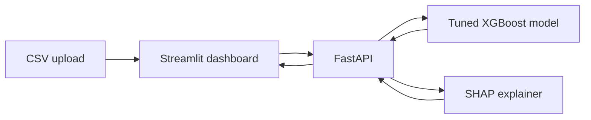

# Intelligent Financial Fraud Detection

An end-to-end machine learning project for identifying potentially fraudulent credit card transactions. The project covers data cleaning, SQL analysis, exploratory data analysis, imbalanced classification, model comparison, hyperparameter tuning, SHAP explainability, and a local prediction interface built with FastAPI and Streamlit.

The final model is a tuned XGBoost classifier. Users can upload a transaction CSV through the Streamlit dashboard, receive fraud predictions from the FastAPI service, and inspect individual predictions with SHAP explanations.

## Project features

- Data inspection, duplicate removal, and SQLite database integration.
- SQL queries and exploratory data analysis (EDA).
- Chronological training, validation, and test splits.
- Comparison of Logistic Regression, Random Forest, and XGBoost models.
- Experiments with class weighting and SMOTE to address class imbalance.
- XGBoost hyperparameter tuning using time-series cross-validation.
- Model evaluation using precision, recall, F1-score, Average Precision, and ROC-AUC.
- Global and fraud-specific model explanations using SHAP.
- FastAPI endpoints for single predictions, batch predictions, and explanations.
- Streamlit dashboard for CSV upload, prediction summaries, transaction results, and individual explanations.

## 1. Dataset

This project uses the **Credit Card Fraud Detection** dataset published by the Machine Learning Group at Université Libre de Bruxelles (ULB).

- Dataset: [Kaggle – Credit Card Fraud Detection](https://www.kaggle.com/datasets/mlg-ulb/creditcardfraud)
- Original size: 284,807 transactions and 31 columns.
- Collection period: two days in September 2013.
- `Time`: elapsed seconds from the first transaction in the dataset, not a calendar timestamp.
- `Amount`: transaction amount.
- `V1` to `V28`: anonymised PCA-transformed input features.
- `Class`: target label (`0` = legitimate, `1` = fraudulent).

The source dataset is not included in this repository. Download `creditcard.csv` from Kaggle and place it in `data/raw/` before running the data preparation scripts.

### Data cleaning results

The initial inspection identified 1,081 duplicate copies. After removing exact duplicate rows, the dataset contained 283,726 transactions.

| Class | Transactions after cleaning |
|---|---:|
| Legitimate | 283,253 |
| Fraudulent | 473 |
| **Total** | **283,726** |

Fraudulent transactions represent approximately **0.167%** of the cleaned dataset. Because of this class imbalance, accuracy alone is not a reliable measure of model performance.

## 2. Project workflow

1. **Data inspection and cleaning:** inspect data types, missing values, duplicate records, and class distribution.
2. **Database integration:** store the cleaned data in SQLite and perform SQL queries on transaction counts, class distribution, and transaction amounts.
3. **Exploratory data analysis:** examine transaction amounts, elapsed-time patterns, feature correlations, and feature distributions.
4. **Data preparation:** sort records by `Time` and divide them into chronological training, validation, and test sets.
5. **Feature preparation:** use `V1`–`V28` and `Amount` as the 29 model features. `Time` is used for chronological ordering and splitting, but is excluded from model training. `Class` is the target.
6. **Model development:** train and compare Logistic Regression, weighted Logistic Regression, Random Forest, and several XGBoost configurations.
7. **Imbalance experiments:** evaluate class weighting and SMOTE. SMOTE is applied to training data only.
8. **Hyperparameter tuning:** compare six XGBoost configurations with three expanding-window `TimeSeriesSplit` folds, using Average Precision as the tuning metric.
9. **Explainability:** use SHAP to understand overall feature importance, fraud-specific feature importance, and individual transaction predictions.
10. **Final evaluation:** evaluate the selected tuned XGBoost model on the held-out chronological test set.
11. **Local inference demo:** serve predictions and SHAP explanations through FastAPI and provide a CSV-based user interface with Streamlit.

### Chronological data split

The cleaned data was sorted by `Time` before splitting. Earlier transactions are used for training, followed by validation and then testing.

| Partition | Records | Legitimate | Fraudulent | Fraud rate |
|---|---:|---:|---:|---:|
| Training | 198,609 | 198,243 | 366 | 0.184% |
| Validation | 42,560 | 42,505 | 55 | 0.129% |
| Test | 42,557 | 42,505 | 52 | 0.122% |
| **Total** | **283,726** | **283,253** | **473** | **0.167%** |

The validation set was used for model comparison and threshold selection. The test set was kept separate for final evaluation. `StandardScaler` was fitted on training data only; scaled features were used for Logistic Regression and the SMOTE experiment. Tree-based models used the original feature values.

## 3. Model comparison

The table shows the selected validation threshold and the corresponding validation precision, recall, and F1-score for each tested model configuration.

| Model | Threshold | Precision | Recall | F1-score |
|---|---:|---:|---:|---:|
| Logistic Regression | 0.10 | 72.31% | 85.45% | 78.33% |
| Weighted Logistic Regression | 0.90 | 21.93% | 90.91% | 35.34% |
| Random Forest | 0.30 | 97.67% | 76.36% | 85.71% |
| Original XGBoost | 0.70 | 100.00% | 76.36% | 86.60% |
| Weighted XGBoost | 0.95 | 97.67% | 76.36% | 85.71% |
| XGBoost with SMOTE | 0.90 | 93.48% | 78.18% | 85.15% |
| **Tuned XGBoost** | **0.50** | **100.00%** | **76.36%** | **86.60%** |

The tuned XGBoost model was selected as the final model. Its hyperparameters were:

| Parameter | Value |
|---|---:|
| `n_estimators` | 300 |
| `max_depth` | 4 |
| `learning_rate` | 0.05 |
| `min_child_weight` | 3 |
| `subsample` | 0.8 |
| `colsample_bytree` | 0.8 |
| `reg_lambda` | 5 |

The best configuration achieved a mean Average Precision of **0.7678** across three chronological cross-validation folds. This is a cross-validation result and should not be directly compared with the validation-set Average Precision below.

## 4. Final test results

The tuned XGBoost model was evaluated on the held-out test set using the threshold of **0.50**, selected before the test evaluation.

| Metric | Test result |
|---|---:|
| Accuracy | 99.96% |
| Precision | 95.00% |
| Recall | 73.08% |
| F1-score | 82.61% |
| Average Precision | 0.7543 |
| ROC-AUC | 0.9817 |

Confusion matrix (rows = actual class, columns = predicted class):

```text
                 Predicted legitimate   Predicted fraud
Actual legitimate          42,503                 2
Actual fraud                   14                38
```

The model correctly detected **38 of 52** fraudulent test transactions, missed 14, and produced 2 false positives.

The test results are lower than the validation results, particularly for Average Precision. This suggests that ranking performance was weaker in the later test period, although the small number of fraud cases means the result is subject to sampling uncertainty. The dataset covers only two days, so these results do not establish how the model would perform on newer or real-world banking transactions.

## 5. SHAP explainability

SHAP was used with the tuned XGBoost model to examine both overall model behaviour and individual predictions. The SHAP values for this model explain contributions in the model's raw output space (log-odds), not direct percentage-point changes in probability.

### Overall validation sample

Mean absolute SHAP values from a random sample of 1,000 validation transactions ranked the following features highest:

| Rank | Feature | Mean absolute SHAP |
|---:|---|---:|
| 1 | `V4` | 1.3597 |
| 2 | `V14` | 1.0908 |
| 3 | `V12` | 0.7105 |
| 4 | `V8` | 0.3584 |
| 5 | `Amount` | 0.3296 |
| 6 | `V10` | 0.2988 |

### Fraud-only validation sample

For the 55 fraudulent transactions in the validation set, the highest mean absolute SHAP values were:

| Rank | Feature | Mean absolute SHAP |
|---:|---|---:|
| 1 | `V14` | 3.3859 |
| 2 | `V10` | 1.5134 |
| 3 | `V4` | 1.1026 |
| 4 | `V12` | 0.7576 |
| 5 | `V17` | 0.6510 |

These values describe how the model uses the available features; they do not demonstrate causal relationships. The original meanings of `V1`–`V28` are not available because these variables are anonymised PCA components. The fraud-only analysis is based on 55 cases and should be interpreted cautiously.

## 6. API and dashboard

The project includes a local inference application with a FastAPI backend and Streamlit frontend.



### FastAPI endpoints

| Method | Endpoint | Purpose |
|---|---|---|
| `GET` | `/health` | Check whether the API and model are available. |
| `POST` | `/predict` | Predict one transaction. |
| `POST` | `/predict/batch` | Predict multiple transactions in one request. |
| `POST` | `/explain` | Return a SHAP explanation for one transaction. |

FastAPI's interactive API documentation is available at `http://127.0.0.1:8000/docs` while the local API is running.

### Streamlit dashboard

The dashboard in `app/dashboard.py` provides:

- CSV upload and input validation.
- A preview of the uploaded data.
- Batch fraud predictions through the FastAPI backend.
- A summary of predicted fraudulent and legitimate transactions.
- A transaction results table with fraud probabilities and predicted labels.
- Downloadable prediction results.
- Individual transaction explanations showing the top SHAP feature contributions.

For dashboard uploads, include the 29 model features (`V1` to `V28` and `Amount`). The dashboard also accepts optional `Time` and `Class` columns; `Class` can be used to compare predictions with known labels. Each prediction batch is limited to 5,000 transactions.

### Run the application locally

Complete the installation steps below and generate the tuned model file at `outputs/models/xgboost_tuned.json` before starting the API. The dataset, processed files, and model artifacts are kept locally and are not included in the Git repository.

**Terminal 1 – start the FastAPI backend:**

```powershell
uvicorn src.api:app --reload
```

**Terminal 2 – start the Streamlit dashboard:**

```powershell
streamlit run app/dashboard.py
```

Open the local URL printed by Streamlit in your browser. Keep the FastAPI terminal running while using the dashboard. The dashboard is configured to connect to `http://127.0.0.1:8000`.

To test the API separately, start FastAPI first and then run:

```powershell
python src/test_api.py
```

The API test script uses a row from the locally generated validation data, so the preparation workflow must have been run first.

## 7. Repository structure

The main source files and generated reports are organised as follows. Some data and model files are created locally and intentionally excluded from Git.

```text
intelligent-fraud-detection/
│
├── app/
│   └── dashboard.py
│
├── data/                         # local data; excluded from Git
│   ├── raw/
│   └── processed/
│       ├── fraud_detection.db
│       ├── train.csv
│       ├── validation.csv
│       ├── test.csv
│       └── scaled/
│
├── outputs/
│   ├── figures/                  # EDA and model visualisations
│   ├── models/                   # locally saved models; excluded from Git
│   ├── fraud_shap_importance.csv
│   ├── random_forest_feature_importance.csv
│   ├── shap_feature_importance.csv
│   └── xgboost_feature_importance.csv
│
├── reports/
│   ├── final_confusion_matrix.csv
│   ├── final_test_metrics.csv
│   └── model_comparison.csv
│
├── src/
│   ├── inspect_data.py
│   ├── check_duplicates.py
│   ├── create_database.py
│   ├── run_sql_queries.py
│   ├── eda.py
│   ├── prepare_data.py
│   ├── scale_features.py
│   ├── train_logistic_regression.py
│   ├── train_weighted_logistic.py
│   ├── train_random_forest.py
│   ├── train_xgboost.py
│   ├── train_xgboost_weighted.py
│   ├── train_xgboost_smote.py
│   ├── tune_xgboost.py
│   ├── explain_shap.py
│   ├── final_evaluation.py
│   ├── create_reports.py
│   ├── evaluate_tuned_xgboost.py
│   ├── compare_*_thresholds.py
│   ├── api.py
│   └── test_api.py
│
├── requirements.txt
├── .gitignore
└── README.md
```

## 8. Setup and installation

### 1. Clone the repository

```powershell
git clone https://github.com/nickaliff/Intelligent-Financial-Fraud-Detection.git
cd Intelligent-Financial-Fraud-Detection
```

### 2. Download the dataset

Download `creditcard.csv` from the [Kaggle dataset page](https://www.kaggle.com/datasets/mlg-ulb/creditcardfraud) and place it here:

```text
data/raw/creditcard.csv
```

Create the required local folders if they do not already exist:

```powershell
New-Item -ItemType Directory -Force -Path data/raw, data/processed, outputs/figures, outputs/models, reports | Out-Null
```

### 3. Create and activate a virtual environment

```powershell
python -m venv .venv
.\.venv\Scripts\Activate.ps1
```

### 4. Install dependencies

```powershell
python -m pip install --upgrade pip
pip install -r requirements.txt
```

## 9. Reproducing the project workflow

Run the scripts from the project root directory, in workflow order, because later stages depend on files generated by earlier stages.

### Data inspection and preparation

```powershell
python src/inspect_data.py
python src/check_duplicates.py
python src/create_database.py
python src/run_sql_queries.py
python src/eda.py
python src/prepare_data.py
python src/scale_features.py
```

### Model experiments and tuning

Run the model experiment scripts to reproduce the baseline and imbalance-handling comparisons:

```powershell
python src/train_logistic_regression.py
python src/train_weighted_logistic.py
python src/train_random_forest.py
python src/train_xgboost.py
python src/train_xgboost_weighted.py
python src/train_xgboost_smote.py
```

Then run the tuned model workflow and the relevant evaluation and explainability scripts:

```powershell
python src/tune_xgboost.py
python src/evaluate_tuned_xgboost.py
python src/explain_shap.py
python src/final_evaluation.py
python src/create_reports.py
```

The threshold-comparison scripts (`compare_*_thresholds.py`) can also be run to inspect alternative decision thresholds. Run the scripts from the project root and check their outputs before proceeding to the next stage.

## 10. Limitations and future improvements

- The dataset covers only two days in September 2013 and may not represent current transaction behaviour.
- Fraud observations are limited, especially in the validation and test partitions. Metrics and threshold comparisons therefore have sampling uncertainty.
- Most input features are anonymised PCA components, which limits direct business interpretation.
- The dataset does not provide customer histories, merchant details, or investigation outcomes.
- The model has been evaluated on a chronological holdout from this dataset, not on live banking traffic.
- The local API and dashboard are a portfolio demonstration. They do not include production authentication, monitoring, payment-system integration, or operational safeguards.

Potential future improvements include evaluating newer and longer-term transaction data, probability calibration, cost-sensitive threshold selection, model monitoring, and testing under a controlled production-like environment.

## Disclaimer

This project is for educational and portfolio purposes only. It is not a production-ready banking fraud detection system and must not be used to make real financial decisions.
